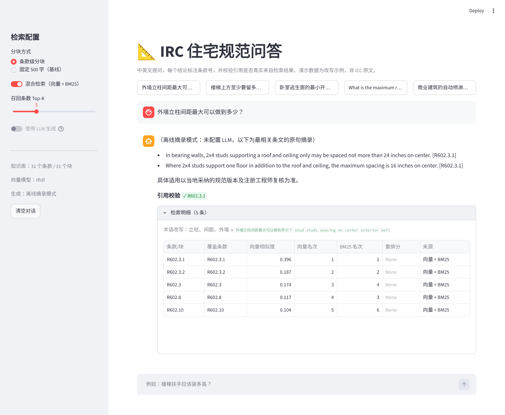
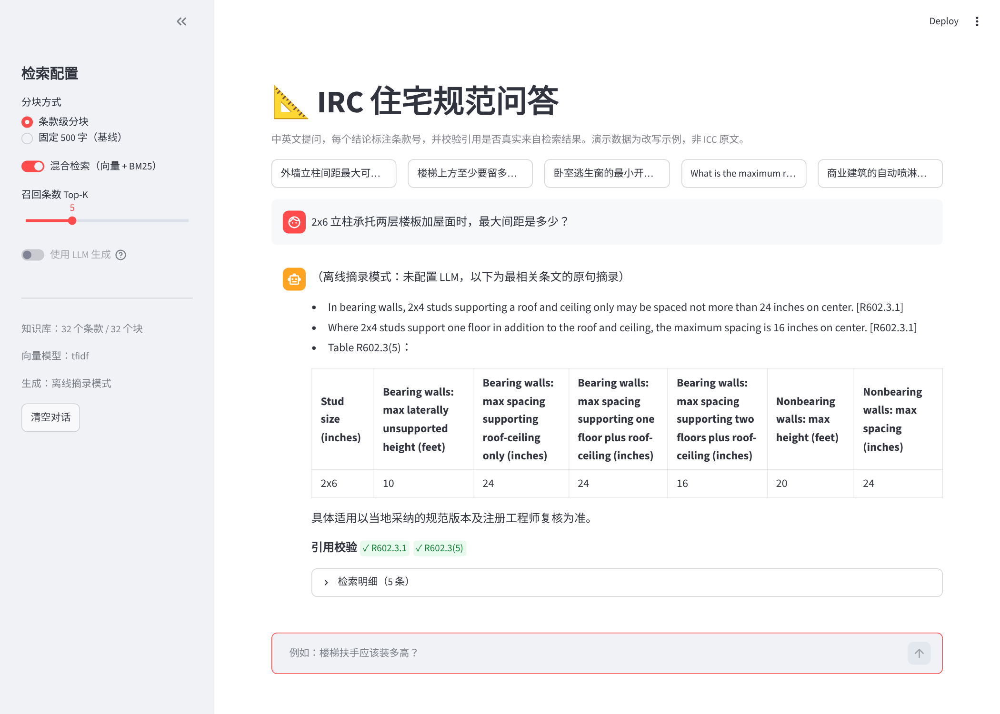

# IRC 建筑规范智能问答（RAG）

用中文或英文提问美国住宅建筑规范（IRC 2018，覆盖建筑、节能、暖通、燃气、给排水、电气全部 43 章），每个结论都标注条款号，并自动检查引用的条款号是否真的出自检索到的原文。知识库里查不到时直接拒答，不编造。





## 为什么做这个

我之前用 DeepSeek V3/R1 测过美国建筑规范问答，发现主要错误是**条文引用错误**：条款号张冠李戴，或者引用不存在的条款。规范问答的价值在于“依据哪一条”，引用一错，答案就没法用于现场判断。这个项目针对这个问题做了四件事：

1. **按条款切块**：一个条款一块，Exception 和主条文放在同一块，块首带“章 > 节 > 条款”的标题路径
2. **表格单独成块**：`Table R602.3(5)` 这类表格保留 Markdown 结构；超长表格按行切开，每块都重复表头
3. **引用校验**：抽出答案里的条款号，区分“出自检索条文”“原文交叉引用”“无依据”三种情况
4. **中文提问英文规范**：中文问题先按术语表补充英文检索词，再用多语言向量模型 bge-m3 检索

## 实测结果

### 全书版（v2）：IRC 2018 第 1～43 章，5212 块

开发集 55 题（50 道库内、5 道库外，约六成中文提问），另有 15 题独立验证集（没有用于调整术语表或阈值）。

| 组别 | 配置 | 召回率@5 | Top-1 | MRR | 引用准确率 | 幻觉引用率 | 拒答准确率 | 误拒率 |
|---|---|---|---|---|---|---|---|---|
| B | 条款级分块 + 向量 | 98% | 78% | 0.86 | 96% | 0% | 100% | 4% |
| C | 条款级分块 + 向量 + BM25 | 100% | 78% | 0.87 | 100% | 0% | 100% | 0% |
| **D** | **条款级分块 + 混合检索 + 重排** | **100%** | **84%** | **0.92** | **98%** | **1%** | **100%** | **0%** |
| D（验证集 15 题） | 同上 | 100% | 92% | 0.96 | 100% | 0% | 100% | 0% |

向量模型 bge-m3，重排 bge-reranker-v2-m3，生成 DeepSeek。完整过程（第一轮结果、错误分析、修复、验证）见 [docs/results_irc2018_full.md](docs/results_irc2018_full.md)。

**主要发现：**

- **错误分析比调参有用**：扩到全书后，第一轮 D 组召回率 92%、误拒率 6%。逐题检查发现没答对的 4 题全是中文提问，正确条款在屋面、电气、暖通章节，术语表没有覆盖（“支撑”还被补成了 bracing，把检索带到墙体支撑条款）。补充 21 个术语后召回率 92% → 100%，误拒率 6% → 0%，验证集上同样是 100% 召回。
- **BM25 是增益还是噪声，取决于术语表**：第一轮 BM25 让中文召回从 86% 降到 79%；术语表补全后，加 BM25 的 C 组反而超过只用向量的 B 组。
- **重排稳定提升排序**：Top-1 比不重排高 6～12 个百分点。
- **引用校验抓到了真实错误**：唯一一条“无依据”引用是模型把 G2439.7.2 抄成了 M2439.7.2。
- **拒答阈值已接近极限**：语料扩大 6 倍后，库内最低相似度 0.574、库外最高 0.571，下一步考虑加问题分类。

### 4 章版（v1）：第 3、5、6、8 章，882 个条款

评测集 40 题（35 道库内、5 道库外）。

| 组别 | 配置 | 召回率@5 | Top-1 | 引用准确率 | 幻觉引用率 | 拒答准确率 | 误拒率 |
|---|---|---|---|---|---|---|---|
| A | 固定 500 字分块 + 向量 | 97% | 63% | 74% | 0% | 100% | 20% |
| B | 条款级分块 + 向量 | 100% | 74% | **100%** | 0% | 100% | **0%** |
| C | 条款级分块 + 向量 + BM25 | 97% | 71% | 97% | 0% | 100% | 3% |
| D | 条款级分块 + 混合检索 + 重排 | 97% | **80%** | 97% | 0% | 100% | 0% |

详见 [docs/results_irc2018.md](docs/results_irc2018.md)。

- **条款级分块最有效**：引用准确率 74% → 100%，误拒率 20% → 0%。固定长度切块把长条文拦腰切断，模型只看到半截，要么引错出处，要么依据不足而拒答。
- **引用校验改为三档**：旧规则把 10%～15% 的引用判为幻觉，逐条核对后发现全部是条文里的交叉引用（如“螺旋楼梯按 R311.7.10.1 执行”）。

## 架构

```
离线：PDF / HTML / 文本 → 格式整理（双栏顺序、分数上下标、去页眉页脚和插图标注、表格）
      → 条款解析 → 条款级分块 → bge-m3 向量（缓存到硬盘） + BM25 索引
在线：提问 → 追问改写 / 术语映射 → 混合检索（RRF 融合） → 重排 → 低分拒答
      → 生成（DeepSeek，逐句标条款号） → 引用校验 → 答案 + 引用卡片
```

| 模块 | 文件 |
|---|---|
| PDF / HTML / 文本转换 | `ircrag/convert.py` |
| 条款与表格解析、分块 | `ircrag/ingest.py` |
| 向量化、向量库（内存 / Milvus Lite）、BM25、RRF、重排、术语改写 | `ircrag/retrieval.py` |
| Prompt、生成、离线摘录、引用校验 | `ircrag/generation.py` |
| 串联与拒答 | `ircrag/pipeline.py` |
| 消融实验、阈值校准、RAGAS | `eval/run_eval.py`、`eval/calibrate.py`、`eval/ragas_eval.py` |
| 演示界面 | `app/streamlit_app.py` |

## 运行

### 快速体验（示例数据，不需要模型和 Key）

```bash
uv venv
uv pip install -r requirements.txt
uv run pytest -q                              # 16 个测试
uv run streamlit run app/streamlit_app.py
```

示例数据 `data/sample/irc_sample.md` 是模仿 IRC 格式的改写文本，只用来跑通流程。没有向量模型时自动退回本地 TF-IDF；没有 LLM Key 时进入“离线摘录模式”，直接摘录相关条文并标注条款号。

### 真实规范

```bash
uv pip install -r requirements-models.txt     # bge-m3 + 重排模型，首次运行下载约 4.5 GB
cp .env.example .env                          # 填 DEEPSEEK_API_KEY，并加一行 IRC_RAG_CONFIG=config.irc2018.yaml

# 1. 自行准备 IRC PDF，放到 data/raw/（已加入 .gitignore），按书签转换第 1～43 章（第 44 章是引用标准清单，不收录）
uv run python -m ircrag.convert data/raw/IRC.pdf --chapters 1-43 -o data/raw/irc.md
# 输出：识别 4342 个条款（其中表格 352 个、术语定义 439 条）；只想要部分章节可写 --chapters 3 5 6 8

# 2. 校准拒答阈值，把建议值填进 config.irc2018.yaml（首次运行会向量化全部 5212 块，CPU 上约 1.5 小时）
uv run python -m eval.calibrate --questions eval/questions_irc2018_full.jsonl

# 3. 消融实验 + 独立验证集
uv run python -m eval.run_eval --questions eval/questions_irc2018_full.jsonl --groups B C D
uv run python -m eval.run_eval --questions eval/questions_irc2018_holdout.jsonl --groups D

# 4. 界面
uv run streamlit run app/streamlit_app.py
```

国内下载模型可先设置 `HF_ENDPOINT=https://hf-mirror.com`；模型下载完成后在 `.env` 里加 `HF_HUB_OFFLINE=1`，避免每次启动都联网检查。Milvus Lite 向量库是可选项（`requirements-milvus.txt`，仅 Linux / macOS），默认的内存向量库就够用。

## 条款编号与切块单元

IRC 各部分的编号规则不同，解析器全部支持：

| 部分 | 章节 | 编号示例 |
|---|---|---|
| 建筑 | 第 1、3～10 章 | R302.1、R1003.9（3～4 位节号） |
| 术语定义 | 第 2 章 | 按词条切块，如 “Habitable space” |
| 节能 | 第 11 章 | N1102.1.2（条款号后带对应 IECC 编号，如 (R402.1.2)） |
| 暖通 | 第 12～23 章 | M1502.4.2 |
| 燃气 | 第 24 章 | G2417.1 |
| 给排水 | 第 25～33 章 | P2708.1 |
| 电气 | 第 34～43 章 | E3902.1 |

全书解析出 3550 个条款、352 张表格、439 条术语定义，切成 5212 块；用正则对照 PDF 原文中的条款号，无遗漏。

## Windows 一键脚本

| 脚本 | 作用 |
|---|---|
| `setup.bat` | 建虚拟环境、安装依赖、创建 `.env`（会提示输入 DeepSeek Key）、跑测试 |
| `calibrate.bat` | 首次运行会向量化全部条文并缓存，然后打印拒答阈值的校准结果 |
| `evaluate.bat` | 在 55 题开发集上跑 B / C / D 三组对比（约 1 小时） |
| `holdout.bat` | 在 15 题独立验证集上跑 D 组（约 15 分钟） |
| `start.bat` | 启动问答界面 |

## PDF 转换做了什么

IRC 的 PDF 直接提取文字会出很多问题，转换器逐一处理：

- **双栏排版**：按“先左栏、再右栏”排列，表格等通栏内容按位置插入，避免左右栏句子穿插
- **分数上下标**：7¾ 中的 3 和 4 是小号字，直接提取会变成“73/4”；按字号识别后还原为 7-3/4，表格内同样处理
- **插图标注**：字号小且几乎全大写的文字块视为插图标注，不混入条文
- **表格**：识别画线表格并转成 Markdown；跨页表格（标题带 “continued”）合并为一张
- **其他**：去掉页眉页脚和页码、拼接连字符断行、还原 Symbol 字体的 × ≥ ≤ 等字符、统一 “2 × 4” 为 “2x4”

转换结果的检查方式：用正则扫描 PDF 原文中所有“条款号 + 标题”行作为对照，4 章版 882 个条款、全书 3550 个条款均无遗漏；并人工抽查净空、踏步高、逃生窗面积、立柱表等条文。

## 测试

`pytest` 共 16 个测试，覆盖分块、表格、条款号检索、引用校验三档判定、拒答、PDF / HTML 转换往返、向量库一致性，以及用模拟接口测试的 LLM 路径（生成、拒答透传、追问改写、空响应重试）。每次提交由 GitHub Actions 自动运行。

## 数据与版权

IRC 的版权归 ICC。本仓库**不包含规范原文**，只包含转换脚本、改写的示例数据和评测题（评测题只记录条款号）。使用真实规范请自行获取文本，放在 `data/raw/`。

## 已知局限

- 开发集 55 题、验证集 15 题，标准答案由本人标注，没有第二人复核
- 术语表是根据开发集错题补充的；验证集结果说明没有明显过拟合，但样本较小
- 按条款号评测：同一要求出现在多个条款（如车库热水器同时见于 P2801.7 和 G2408.2）时，未标注的正确条款会记为未命中
- 全书版库内外向量相似度的间隔只有 0.003，换一批问题可能需要重新校准
- 少量表格标题未识别、少量条款混入插图标注，无框线表格依赖画线识别
- CPU 上 bge-m3 给全书建索引约 2 小时（已做缓存，只需一次），开启重排后每题增加 10～30 秒
- 不处理地方修正案，不做结构计算，结论需由注册工程师复核
